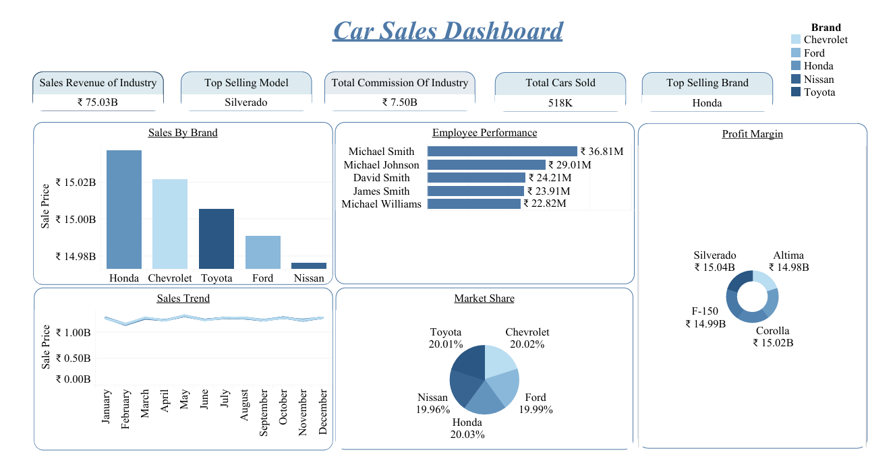

# 🚗 Car Sales Dashboard (Tableau)

## 📌 Project Overview
An interactive **Tableau Business Intelligence dashboard** analyzing automotive sales performance, monthly revenue trends, salesperson productivity, brand market share, and commission metrics across vehicle models.

## 🎯 Business Objectives
* Monitor core dealership KPIs: **Total Sales Revenue (₹75.04B)**, **Total Cars Sold (2.50M)**, **Average Sale Price (₹30.02K)**, and **Total Commission Earned (₹7.50B)**.
* Track **monthly sales trends** to identify seasonal peaks and revenue fluctuations.
* Evaluate **brand-level performance** and **top salesperson rankings** to support incentive and inventory decisions.

## 🛠️ Tools & Skills Used
* **Tableau Desktop:** Calculated fields, interactive dashboard actions, custom KPI cards, dual-axis/trend visualizations, and dynamic filtering.
* **Data Preparation & Aggregation:** Grouping, date-part analysis, and table calculations (*Percent of Total*).
* **Commercial & Sales Analytics:** Salesperson benchmarking, brand share comparison, and commission tracking.

## 📈 Key Insights
* **Revenue & Volume Scale:** Analyzed **2.50 million car sales** generating **₹75.04B** in total revenue at an average price of **₹30.02K** per vehicle.
* **Brand Performance:** Compared revenue and unit share across five major manufacturers (**Ford, Honda, Chevrolet, Toyota, and Nissan**) to evaluate market balance.
* **Salesperson & Model Breakdown:** Built interactive filters allowing management to drill down into individual salesperson performance and specific car models.

## 📂 Repository Contents
* [`Car-sales dashboard.twb`](Car-sales%20dashboard.twb) — Complete Tableau workbook file.
* [`Car sales dashboard.pdf`](Car%20sales%20dashboard.pdf) — Exported PDF version of the dashboard for quick viewing.
* [`Carsales-DashBoard.png`](Carsales-DashBoard.png) — High-resolution dashboard preview.
